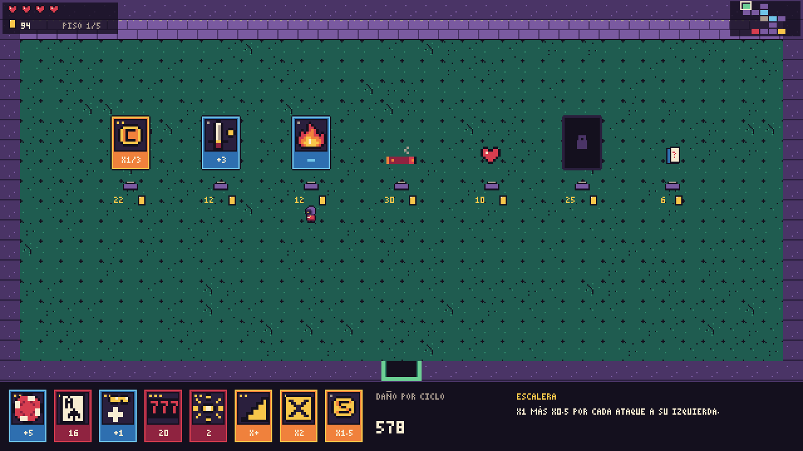
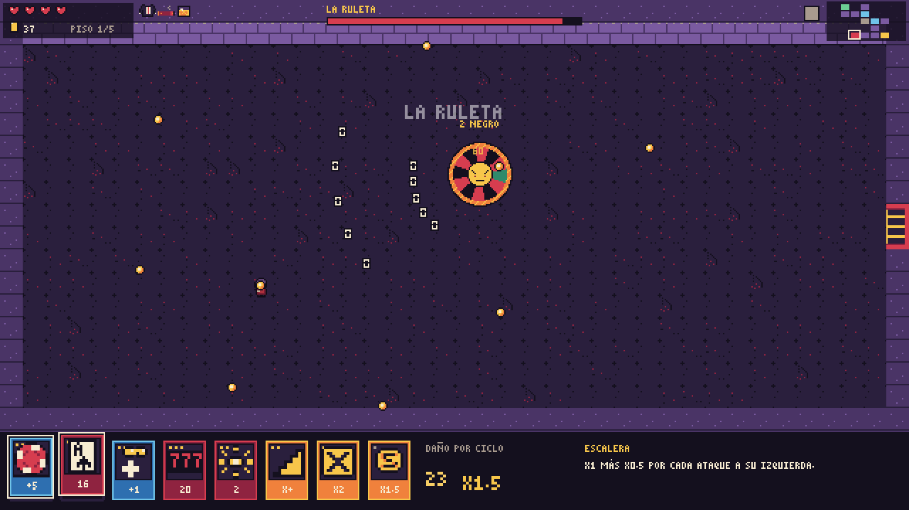

# La Casa Siempre Gana


Un roguelike en un casino subterráneo. Es la mezcla de tres juegos que me encantan: las mazmorras de The Binding of Isaac, las hordas de Vampire Survivors y las cartas de Balatro.

Solo te mueves. Tu personaje ataca por su cuenta, y lo que hace depende de una fila de cartas que se ejecutan de izquierda a derecha en cada ciclo. Un modificador lo gasta el siguiente ataque y un multiplicador solo cuenta lo que tiene a su izquierda, así que la misma mano puede hacer 31 de daño o 93 según cómo la ordenes.

[Tráiler](media/trailer.mp4)

## Qué hay dentro

- 5 pisos generados al azar. Al entrar en una sala se cierran las puertas hasta que no quede nadie.
- 5 jefes: el Pez Rojo siempre abre la partida, y luego salen la Tragaperras, la Ruleta, la Mosca Crupier y el Rey del 21 en orden distinto. Cada uno funciona con las reglas de su juego: la Mosca reparte manos de baccarat y el Rey se queda aturdido si se pasa de 21.
- 45 cartas (Pareja, Full, Comodín, All In, Mano del Muerto...) y 16 objetos pasivos.
- 5 transformaciones si juntas ciertos objetos.
- 4 personajes con su propio mazo y 5 niveles de dificultad.
- Salas de evento: trileros, doble o nada, un prestamista y una barra con un chupito que mejor no probar.
- Lo que desbloqueas se queda guardado entre partidas.
- En español e inglés.

| | |
|---|---|
|  |  |
|  |  |

## Controles

WASD o flechas para moverte, ratón para arrastrar cartas cuando la sala está limpia, E para comprar y Esc para pausar.

## Cómo abrirlo

Hace falta [Godot 4.7](https://godotengine.org/download) (la versión normal, no la .NET). Importas `project.godot` y le das a F5.

## Cómo está hecho

Godot 4 con GDScript. Lo que me parece más interesante:

- `scripts/combo.gd` es toda la lógica de las cartas y no toca la escena, por eso se puede probar sin abrir el juego.
- Los enemigos no usan físicas. `scripts/horda.gd` los mueve a mano con una rejilla, porque la idea es que vaya fluido en el navegador con muchos en pantalla.
- Los gráficos, la fuente y el sonido no vienen de ningún pack: salen de `tools/generar_sprites.py` y `tools/generar_sonidos.py`. Si cambias la paleta o una nota, relanzas el script y ya está.
- En `tests/` hay pruebas de las reglas y un bot que juega partidas enteras:

```
godot --headless --path . -s res://tests/prueba_combo.gd
godot --headless --fixed-fps 60 --path . -s res://tests/bot.gd -- modo=normal partidas=20
```

Otro proyecto mío, del que viene la mosca del tercer jefe: [mosca-baccarat](https://github.com/jcamara1240-hub/mosca-baccarat).
