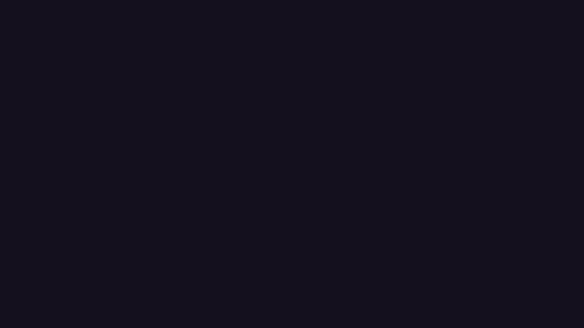
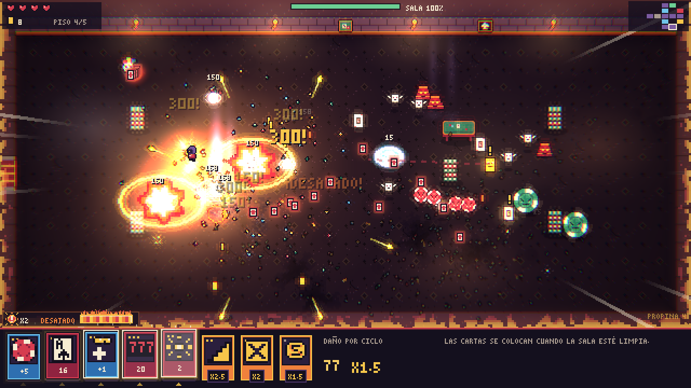
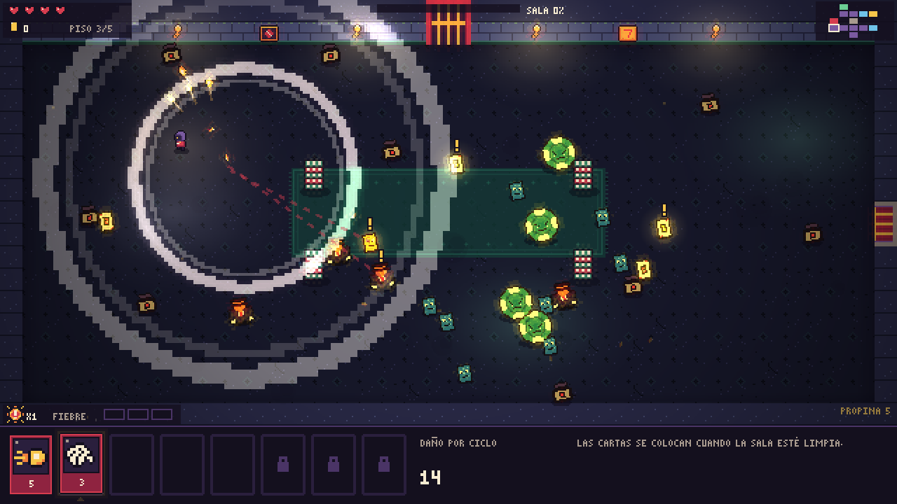
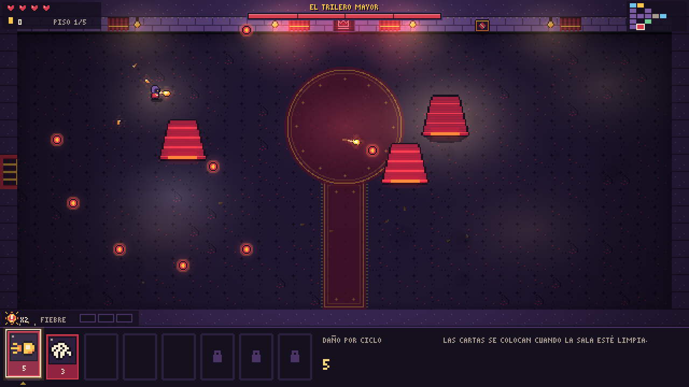
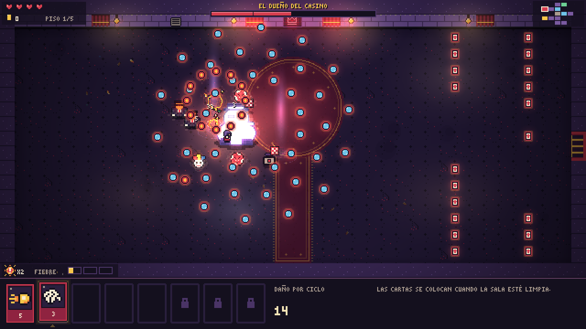
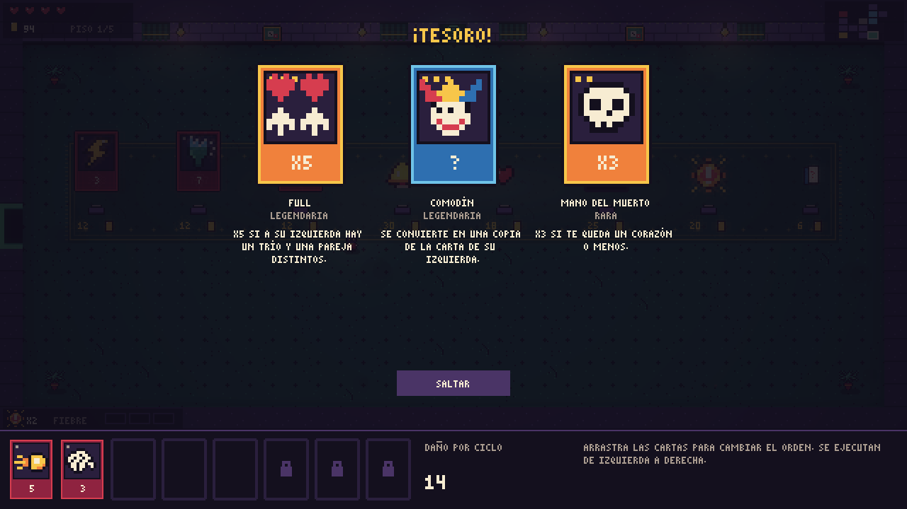
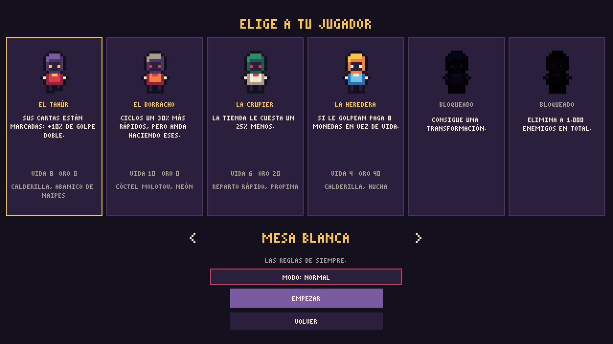

# La Casa Siempre Gana



**[Juega gratis en el navegador](https://hellboy1240.itch.io/la-casa-siempre-gana)**

Un roguelike en un casino subterráneo. Es la mezcla de tres juegos que me encantan: las mazmorras de The Binding of Isaac, las hordas de Vampire Survivors y las cartas de Balatro.

Solo te mueves. Tu personaje ataca por su cuenta, y lo que hace depende de una fila de cartas que se ejecutan de izquierda a derecha en cada ciclo. Un modificador lo gasta el siguiente ataque y un multiplicador solo cuenta lo que tiene a su izquierda, así que la misma mano puede hacer 31 de daño o 93 según cómo la ordenes.

[Tráiler](media/trailer.mp4)

## Qué hay dentro

- 5 pisos generados al azar. Al entrar en una sala se cierran las puertas hasta que no quede nadie.
- 13 jefes: el Pez Rojo siempre abre la partida y el Dueño del Casino siempre la cierra. En medio salen tres entre la Tragaperras, la Ruleta, la Mosca Crupier, el Rey del 21, los Dados Locos, el Revólver, la Bingo, el Trilero Mayor, la Caja Registradora, el Coctelero y el Jugador de Póker. Cada uno funciona con las reglas de su juego: la Mosca reparte manos de baccarat y el Rey se queda aturdido si se pasa de 21.
- 75 cartas (Pareja, Full, Comodín, All In, Mano del Muerto, Recortada, Ruleta Rusa...) y 54 objetos pasivos.
- 10 transformaciones si juntas ciertos objetos.
- 16 tipos de enemigos, entre ellos un crupier que reparte naipes en abanico, un matón con metralleta y un botones que lanza bombas.
- Voltereta, órdagos que limpian la pantalla, mesas de póker que se vuelcan y una Fiebre que acelera las cartas si encadenas bajas.
- 6 personajes con su propio mazo y 5 niveles de dificultad.
- Salas de evento: trileros, doble o nada, un prestamista, una caja fuerte, un mendigo y una barra con un chupito que mejor no probar.
- Reto diario: la misma mazmorra, las mismas oleadas y las mismas tiendas para todo el mundo cada día, con un intento que puntúa y racha de días.
- 38 logros y partida guardada.
- Lo que desbloqueas se queda guardado entre partidas.
- Modo extremo: un golpe y a casa, sin tienda y con jefes que tienen el triple de vida.
- Modo imposible: como el extremo, pero con solo dos ranuras de cartas y sin salas de tesoro.
- Modo infinito: al ganar puedes seguir bajando con lo que llevas, y cada piso es peor que el anterior.
- Se puede jugar en el móvil, con un joystick que aparece donde pones el dedo.
- Se puede jugar con mando, con vibración y ayudas con los botones de cada marca.
- Cooperativo local para dos jugadores en la misma pantalla: cada uno con sus corazones, una fila de cartas compartida y reanimaciones.
- En español, inglés, portugués de Brasil, francés, alemán e italiano.

| | |
|---|---|
|  |  |
|  |  |
|  |  |

## Voltereta, órdago y mesas

Sigues sin apuntar ni disparar: las cartas atacan solas. Lo nuevo es cómo te mueves y lo que tienes a mano.

- **Voltereta**: un tercio de segundo en el que atraviesas balas y enemigos sin que te toquen. Si una bala te pasa rozando mientras ruedas, es un "por los pelos" y sube la Fiebre.
- **Fiebre**: las bajas seguidas la suben hasta tres niveles y cada nivel acelera el ciclo de cartas un 15 %. Baja si pasas un rato sin matar y se vacía si te dan.
- **Órdago**: borra todas las balas enemigas y aparta y aturde a los enemigos. Empiezas con dos, se rellenan al bajar de piso y en la tienda se compran más.
- **Mesas de póker**: se vuelcan rodando contra ellas o con E. Al caer empujan a quien pillan y luego hacen de parapeto hasta que se rompen.
- Las cartas nuevas son armas de los años 20 (recortada, metralleta, cartucho de dinamita, láser de seguridad, corcho de champán, fichas trampa, botella rota) y cartas que premian rodar, guardar órdagos o ir con la Fiebre alta.

## Más deprisa y al límite

Lo último ha sido apretar el ritmo: que todo vaya más rápido y que el momento en que estás a punto de morir sea cuando más te lo juegas. Sigues sin apuntar ni disparar.

- **Desatado**: si aguantas la Fiebre al máximo un momento en plena pelea, te desatas unos segundos. Las cartas van todavía más rápido y tú corres más. Cada baja lo alarga un poco y un golpe lo corta.
- **Al límite**: con un corazón o menos corres más y la Fiebre sube antes (en el modo extremo no cuenta, porque ahí siempre vas así). Los bordes de la pantalla se ponen rojos y, en plena pelea, suena un latido.
- **Roce**: si una bala te pasa rozando sin que ruedes, también sube la Fiebre.
- **Propina por rapidez**: en las salas normales corre un reloj. Si la limpias a tiempo te llevas unas monedas, y el doble si vas sobrado.
- Los enemigos dejan una marca en el suelo antes de aparecer, cada oleada tiene su rótulo y las bajas especiales (la última de la sala, un élite o muchas seguidas) acaban en un remate más gordo. Las balas de las cartas también van más rápidas.
- **Música que aprieta**: en los pisos y con los jefes, la música sube de tono con la intensidad de la pelea y le entra una capa de percusión y bajo que va clavada a ella. Fuera de pelea baja un poco, en cámara lenta se arrastra y al límite deja sitio al latido, que va a tempo. Todo se hace con el volumen y el tono de los reproductores, porque los buses de audio creados por código dejan mudo el juego en el navegador.
- **Más vistoso**: luces y sombras en cada sala, casquillos y trozos de ficha que se quedan en el suelo hasta que sales y un posproceso que hace arder el borde con la Fiebre, tiñe la pantalla al desatarte y la enrojece al límite. El jugador y las balas enemigas se ven siempre por encima de todo eso.

## Hardcore

La última ronda va de que ganar cueste de verdad, sin daño que no se pueda esquivar.

- **Dificultad procedural**: cada sala sale de una tirada (`scripts/director.gd`). Decide cómo se reparte el presupuesto de enemigos entre las oleadas, en porcentajes (goteo, crescendo, avalancha, emboscada o asedio), qué enemigo sale más y si la sala trae una regla propia: Mesa Caliente, Fichas de Plomo, Sala VIP, Lluvia de Naipes o Casa Llena. Encima va la presión: sube si limpias salas sin que te toquen y baja con cada golpe.
- **Oleadas por porcentaje**: la siguiente oleada entra cuando has matado la parte de la anterior que pide la sala (entre el 40 % y el 80 %), no por reloj. Arriba se ve el porcentaje de la sala y las muescas de presión.
- **Enemigos con más recursos**: la mitad de las fichas te corta el paso, el Portero placa en línea recta, los élites aceleran a los que tienen cerca y sueltan un anillo de balas al morir, el dado bomba revienta aunque lo mates antes de que llegue, la cámara dispara a donde vas y los últimos de la sala se desesperan.
- **Menos margen**: enemigos y balas más rápidos, más enemigos, jefes con más vida y patrones más densos, medio segundo de invulnerabilidad tras un golpe y, desde el piso 3, cada golpe quita un corazón entero. Hay menos oro y las curas cuestan más.
- **Te mueves más rápido**: un 25 % más de velocidad y una voltereta más larga.
- **Ocho objetos nuevos y una transformación**: Chaleco Antibalas, Espuelas, Cronómetro, Trofeo de Caza, Bala de Plata, Navaja de Afeitar, Campana de Recepción y Espejo de Mano. Con tres de los de caza te conviertes en El Cazador.
- **Más luz y más cine**: la sala se queda en penumbra durante la pelea, las balas enemigas iluminan el suelo, los focos del casino barren la sala, los jefes laten (en rojo cuando se enfadan) y las luces se desbordan con un resplandor. Los jefes entran y caen con franjas de cine y la cámara acercándose.
- **Más fácil de leer**: los ataques en línea recta enseñan por dónde van a pasar, se ve tu caja de choque cuando hay balas cerca y las cartas cuyo multiplicador crece (Racha Caliente, Hucha, Fiebre, Mesa Llena...) enseñan lo que multiplican ahora mismo.

## La sala de apuestas, los raros y el Contrato

- **Sala de apuestas**: en algunos pisos hay una sala con una tragaperras y una ruleta. Se juega con monedas del juego (o con un corazón, si vas sin blanca) y lo mismo te sale un 777 que una emboscada.
- **Raros y élites**: algunos enemigos salen con un modificador (Veloz, Blindado, Explosivo, Divisor...) y los élites con dos, nombre propio y mejor botín.
- **Contrato de la Casa**: cuando ganas con un personaje puedes firmar cláusulas que lo ponen más difícil (un corazón menos, tienda más cara, jefes con más vida...). Cada una suma calor, y el récord de calor se guarda por personaje. Los premios son solo de aspecto: dorsos de carta y un traje de gala.
- **Mesas por personaje**: cada personaje sube de mesa por su cuenta y lleva una ficha con la más alta que ha ganado.
- **La cuenta de las cartas**: en cada ciclo se ve lo que suma o multiplica cada carta y el total.
- **Otra mano**: al morir puedes repetir sin pasar por el menú, y el Dueño del Casino te suelta un comentario según qué te haya matado.
- **Tabla mundial del reto diario**: el cliente y el servidor están en el repositorio (`scripts/online.gd` y `servidor/`), pero viene apagada hasta que se configura un servidor.

## Controles

Con mando: stick o cruceta para moverte, A/Cruz o RB para la voltereta, X/Cuadrado o LB para el órdago, Y/Triángulo para interactuar, Select para ordenar las cartas y Start para pausar.

Cooperativo: en la selección de personaje, el segundo jugador se une con Start en otro mando o con el 5 en el teclado (flechas para moverse, Intro para la voltereta, Mayús derecha para el órdago y Fin para interactuar).

Con teclado: WASD o flechas para moverte, Espacio o Shift (o clic derecho) para la voltereta, Q o F para el órdago, E para volcar una mesa o comprar, ratón para arrastrar cartas cuando la sala está limpia y Esc para pausar. En el móvil, desliza el dedo por la sala para andar; la voltereta y el órdago tienen su propio botón y las cartas se arrastran igual.

## Cómo abrirlo

Para jugar basta con [la página de itch.io](https://hellboy1240.itch.io/la-casa-siempre-gana), donde también hay versión para Windows. Para tocar el código hace falta [Godot 4.7](https://godotengine.org/download) (la versión normal, no la .NET). Importas `project.godot` y le das a F5.

## Cómo está hecho

Godot 4 con GDScript. Lo que me parece más interesante:

- `scripts/combo.gd` es toda la lógica de las cartas y no toca la escena, por eso se puede probar sin abrir el juego.
- Los enemigos no usan físicas. `scripts/horda.gd` los mueve a mano con una rejilla, porque la idea es que vaya fluido en el navegador con muchos en pantalla.
- Los gráficos, la fuente y el sonido no vienen de ningún pack: salen de `tools/generar_sprites.py` y `tools/generar_sonidos.py`. Si cambias la paleta o una nota, relanzas el script y ya está.
- En `tests/` hay pruebas de las reglas y un bot que juega partidas enteras:

```
godot --headless --path . -s res://tests/prueba_combo.gd
godot --headless --fixed-fps 60 --path . -s res://tests/bot.gd -- modo=normal partidas=20
```

Otro proyecto mío, del que viene la mosca del tercer jefe: [mosca-baccarat](https://github.com/jcamara1240-hub/mosca-baccarat).
